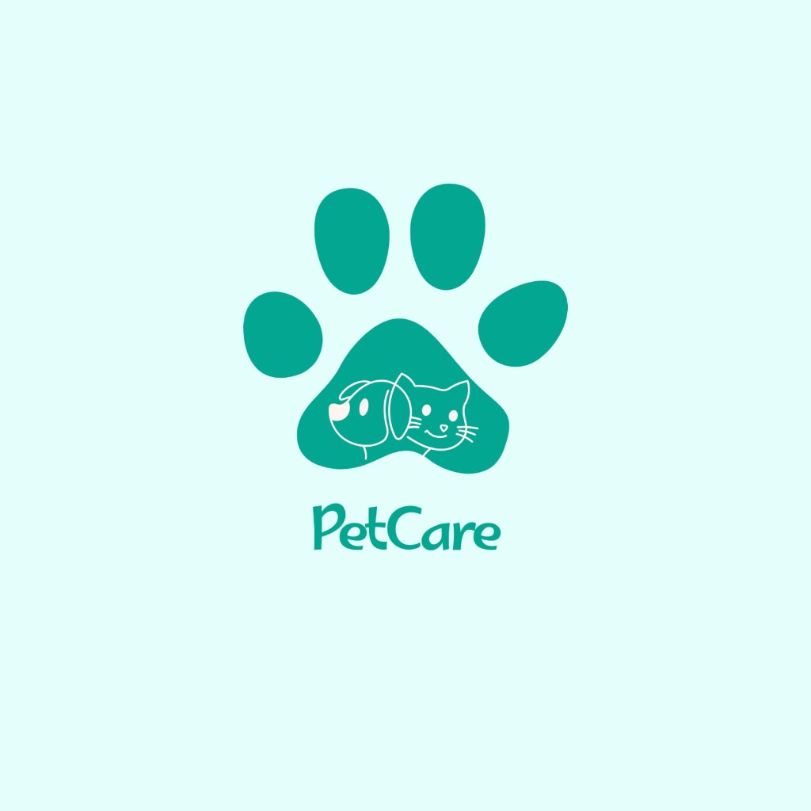

  
  <h1>🐾 تطبيق ومنصة PetCare</h1>
  
<strong>كل ما يحتاجه أليفك في مكان واحد | رعاية بيطرية وعناية متكاملة</strong>

  

    <a href="https://ashrafnsali-bit.github.io/PetCare/"><b>🌐 زيارة الموقع المباشر (Live Website)</b></a> •
    <a href="https://ashrafnsali-bit.github.io/PetCare/download.html"><b>📲 الرابط الذكي للتحميل (Smart Link)</b></a>
  

  

    
    
    
  

---

## 🎨 الهوية البصرية والألوان المعتمدة (من الشعار)
- **اللون الرئيسي (PetCare Teal):** `#03a691` (متدرج إلى `#018574`)
- **الخلفية الناعمة المتطابقة مع الشعار (Mint Tint):** `#e4fefb` و `#f7fdfc`
- **لون النصوص والتباين العالي:** `#0f2a30`
- **الذهبي للإشادة والتقييمات:** `#ff9f43`
- **الخطوط:** خط `Cairo` العربي الأنيق و `Plus Jakarta Sans` للمحتوى اللاتيني.

---

## 📁 هيكلية ملفات المشروع

| الملف | الوصف والغرض |
| :--- | :--- |
| `index.html` | الصفحة التعريفية الرئيسية (Landing Page) المتكاملة والشاملة لكافة المحاور الـ 5. |
| `download.html` | الرابط الموحد الذكي (**Smart Link**) لحملات التواصل الاجتماعي، يتعرف تلقائياً على نظام تشغيل الجوال ويوجهه للمتجر المناسب. |
| `privacy.html` | وثيقة **سياسة الخصوصية** الرسمية المتوافقة مع إرشادات متجر Apple ومتجر Google Play ونظام حماية البيانات الشخصية. |
| `terms.html` | وثيقة **الشروط والأحكام** الرسمية التي تنظم باقات Wellness والاشتراكات ومسؤولية الخدمات البيطرية. |
| `support.html` | صفحة **الدعم الفني وتواصل معنا** المستقلة مع نموذج إرسال التذاكر، وأرقام الطوارئ، والأسئلة السريعة. |
| `css/style.css` | نظام التصميم الكامل، التجاوب مع مختلف الشاشات، الوضع الليلي الخفيف، والرسوم المتحركة. |
| `js/main.js` | منطق التفاعل، التبديل اللغوي (عربي / إنجليزي)، تبديل أسعار الباقات، ونوافذ الـ QR Code. |
| `assets/` | مجلد الوسائط والشعارات: الشعار الشفاف، الأيقونة، الباركود المخصص QR، والصور التوضيحية المولدة. |

---

## 🌟 المحاور والأقسام المنجزة بالموقع

### 1. الواجهة الرئيسية (Hero Section)
- عنوان رئيسي مشجع: *"كل ما يحتاجه أليفك في مكان واحد"*.
- أزرار التحميل الرسمية: **Download on App Store** و **Get it on Google Play**.
- زر مسح رمز الـ QR السريع لشاشات الكمبيوتر.
- **Interactive Smartphone Mockup:** واجهة جوال تفاعلية حية تحاكي تطبيق PetCare، تحتوي على تنبيهات صحية لأليف المستخدم، حجز المواعيد، وبطاقة الأليف الصحية.
- مؤشرات الثقة الفورية: تقييم 4.9★، +15,000 أليف مسجل، و +120 عيادة وصالون.

### 2. أبرز خدمات التطبيق (Our Services - المحاور الـ 5)
1. **الخدمات البيطرية:** حجز العيادات، الزيارات المنزلية، الاستشارات 24/7، والسجل الطبي الرقمي.
2. **العناية والنظافة (Grooming):** باقات الاستحمام والحلاقة المتنقلة عند باب المنزل أو في الصالونات المعتمدة.
3. **متجر المستلزمات والأغذية:** أطعمة صحية ومكملات غذائية مع توصيل سريع ومباشر.
4. **برامج الرعاية الصحية (Pet Wellness Plans):** خطط اشتراك استباقية توفر حتى 45% من الفواتير البيطرية.
5. **الخدمات المجتمعية وتبني الحيوانات:** تنبيهات فورية للحيوانات المفقودة، وبرامج التبني المجتمعية.

### 3. شرح باقات الرعاية الصحية (Wellness Plans Preview)
- مفتاح تفاعلي للتبديل بين الاشتراك الشهري والسنوي (مع شهرين مجاناً).
- **باقة أليف واحد (Single-Pet):** تغطي 4 كشوفات مجانية، التطعيمات الأساسية، وخصومات 20% على Grooming و 15% على المتجر (وفر حتى 35%).
- **باقة العائلة (Multi-Pet Plan):** تغطي حتى 3 حيوانات، كشوفات غير محدودة، لقاحات مجانية، وخصم 30% على الحلاقة (وفر حتى 45%).
- زر دعوة مباشر: "اشترك الآن عبر التطبيق".

### 4. كيف يعمل التطبيق؟ (How It Works)
- خطوة 1: حمّل التطبيق مجاناً في ثوانٍ.
- خطوة 2: أنشئ ملف أليفك الصحي وسجله الطبي.
- خطوة 3: احجز خدماتك أو اشترك في الباقة بلمسة واحدة.

### 5. شركاء النجاح (Partner Clinics & Brands)
- استعراض العيادات والمستشفيات البيطرية وصالونات Grooming والعلامات الغذائية المعتمدة.
- نافذة منبثقة مخصصة لأصحاب العيادات والمتاجر لتقديم طلبات الانضمام للشبكة.

### 6. الموثوقية وتوافق متاجر التطبيقات (App Store Compliance)
- روابط مباشرة ومستقلة لـ:
  - **سياسة الخصوصية (Privacy Policy)**
  - **الشروط والأحكام (Terms & Conditions)**
  - **الدعم الفني وتواصل معنا (Support / Contact Us)**
- رمز استجابة سريعة (**Branded QR Code**) يحمل أيقونة PetCare في مركزه.
- توفير خاصية التبديل الفوري بين **العربية** و **الإنجليزية** بنقرة زر.
